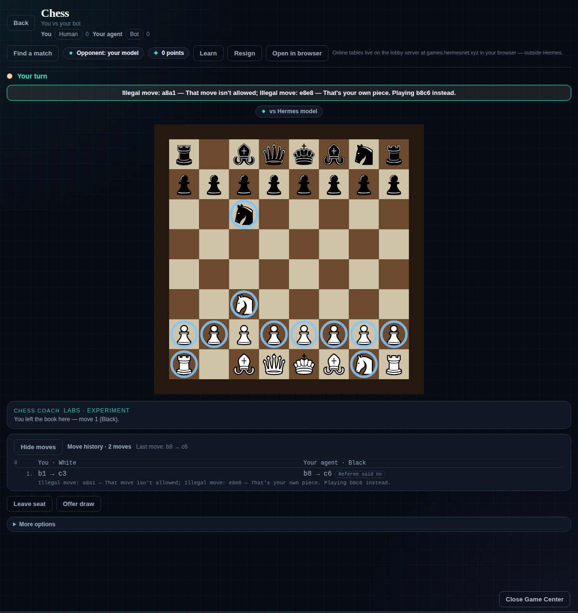

# Game Center (hermes-gameshelf)
_Applies to Game Center 1.0.0 · last revised 2026-11-11 (ffbe5625)_

Eighteen games Hermes can actually play — and a referee that refuses an illegal move out loud. The model proposes the move, the referee decides, and the refusal is kept in the game record and shown on the board.

[](scripts/test.sh) [](LICENSE) [](plugin.yaml) [](plugin.yaml)

## Install

```bash
hermes plugins install KeyArgo/hermes-game-center --yes-deps --enable
```

That puts the plugin in `~/.hermes/plugins/hermes-gameshelf/` and copies the Games page into the Desktop app from the same package. Nothing else is needed — no watch, no server, no model. The eleven Play games run on this computer against the built-in player, and no network call happens unless you turn online play on.

| If you see | Do this |
|---|---|
| No **Games** entry in the Desktop sidebar | Command palette (Ctrl+K), then **Reload desktop plugins** |
| An AI seat, hint or `Improve` does nothing | Those run through your Hermes model — set one with `hermes model`, or Settings → Models → **Game Shelf opponent** |

The plugin's manifest name is `hermes-gameshelf`; the repository is `hermes-game-center`. `enable`, `disable` and `remove` take the manifest name.



On the board above: a model seat proposed `a8a1` and `e8e8` for black. The referee named each move and its reason in one sentence, refused both, and the built-in player moved `b8 → c6` instead. The sentence is badged on the move and recorded in the game's own state.

## What you get

- **Real rules engines, and a referee that says no.** The model proposes, the referee decides. An illegal move is refused in plain words — the move, then the reason — the built-in player moves instead, and the refusal is kept in the game record and shown on the board.
- **Play people, inside Hermes.** Online play joins one shared lobby — the Hall — with a chat, a list of who is here, and play requests. It is off until you turn it on.
- **Your Hermes model as an opponent.** Give a seat to your own model: it gets the board and the legal moves and must answer with one legal move. Any provider works, including a free one.
- **Slots over the chat.** One Slots game on the Jackpot cabinet, which can float over the conversation.
- **Lessons and a hint**, on real positions, each replayed through the game's own rules — so a lesson can never teach an illegal move.
- **Online is optional and off by default.** The games, lessons, hints and the computer opponent run on this computer and keep working with the server down.

## The games

The **Play** shelf is the curated list in [shelf/curated.json](shelf/curated.json) — eleven games, and only a reviewed commit changes it. A plugin cannot add its own game to Play from its manifest.

| Game | Board | Moves | Draw rules |
|---|---|---|---|
| Connect Four | 7 × 6 | drop in a column | full board |
| Reversi | 8 × 8 | flip along both lines | no moves for either side |
| Checkers | 8 × 8 | captures are compulsory | 80 moves without a capture or crowning |
| Breakthrough | 8 × 8 | step or capture diagonally forward | none — every game ends |
| Gomoku | 15 × 15 | five or more in a row | full board |
| Chess | 8 × 8 | castling, en passant, promotion | repetition, fifty moves, insufficient material |
| Go | 9 × 9 | area scoring, two passes end it | none — 7.5 komi rules out a tie |
| Hex | 11 × 11 | join your two sides first | none |
| Sea Battle | 10 × 10 | place five ships, then fire | none — a fleet always sinks |

**Blackjack** (one hand against the house) and **Slots** (the Jackpot cabinet) are the two Play games that are not boards. The four **talking tables**, the two experiments **Doctrine** and **Olympus Arena**, and the workshop prototypes sit behind the small **Experimental** link.

The page opens on **Play** with the lobby beside it, and four links above it: **How to play**, the **Experimental** shelf, **Settings** and **Community creations** (the **Champions** tab beside *Games* is a placeholder — see below). **Settings** carries your name, the per-game match alerts, table sounds and the Jackpot over-chat switch, and shows the **version chip** for this install at the top — `v1.0.0 · 2026-11-11 · <commit>`, click to copy. The same chip is drawn at the top of the Games screen, so the build on screen can be named at a glance.

## Playing

`/games` opens the shelf; `/games <game> new` starts a table, `/games <game> state` shows it, and `/games <game> lesson` then `lesson next` walks a lesson. Moves, by game:

- Connect Four — `move 4`, a column 1 to 7.
- Reversi — `move d3`, `a1` at the top left. No legal move means you pass.
- Gomoku — `move h8` on 15 × 15.
- Checkers — `move c3 d4`, or a full jump chain `move c3 e5 c7`.
- Breakthrough — `move b2-b3`; a diagonal move onto an enemy pawn takes it.
- Chess — `move e2e4`, and `move e7e8q` to promote.
- Go — `move e5`, a1 at the top left; `pass` twice ends the game.
- Hex — `move f6`, a1 at the top left.
- Sea Battle — `place carrier a1 h` and `fire e5`; on the page, drag a ship onto your waters, a click turns it.
- Blackjack — `hit`, `stand`, `double`; Slots — `bet50`, then `spin`.

In Hermes Desktop, **Games** in the sidebar opens the graphical table and you move by clicking the board. The page does not judge moves; it sends the move to the referee, which does.

A move never silently takes a seat: the other person types `/games <game> join` or `sit black` before they can move. `resign` ends your own seat; `leave` opens it before play; `abandon` ends a table without awarding a win; `draw` and `draw accept` offer and take a draw; `rematch` needs both identified people to agree.

## Points

Winning a game pays **100 bonus points** into your Game Center account — one award per win, never for a draw, whatever the board or the opponent. A win by resignation counts, because the referee settles it as a win.

Two currencies live side by side and are not the same thing:

| | What it is | Where it shows |
|---|---|---|
| **Chips** | the cabinet's and the tables' money, spent on spins and bets | the cabinet's balance and its rewards strip |
| **Points** | the award for winning a game, and for using Hermes | the same strip, listed separately from chips |

The wallet keeps points under the key `bonus` and the screen calls them **Points**. There are two ways to earn them:

- **100 points for every game you win** (once per win, never a draw).
- **10 points for every 1,000,000 tokens your chats use**, counting tokens in and out, so the account grows with how much Hermes you actually use. Whole points are paid as they are earned (one point per 100,000 tokens) and the remainder carries into the next reply. The reward strip shows both — `Points: 41 · 3.4M tokens used (10 points per 1M)`.

Points convert to chips at **75%** — four points buy three chips. The Jackpot panel has a slider, a number and **Max**, so you choose how many points to cash in; points are also your ranking, so cashing in lowers it. The other direction (chips back to points) is not built yet.

## Slots over the chat

**Slots** is one Play game, played on the **Jackpot** cabinet. Every spin costs the bet in chips, from the same wallet Blackjack bets from; pick a bet (25 chips up) and press Spin.

Two machines sit above the reels, and you can switch between them mid-session: **Classic** (nine windows, five paylines) and **Hermes Olympus** (one line, three Greek reels). **The odds favour the player**: each machine draws its chance of winning once per session, uniformly between 50% and 52%, and every win pays at least the bet,, and pays back **110%** of what it takes — a person who keeps spinning is slowly up, not slowly down. One session in fifty is a **bonus** at 60% and one in fifty is **cold** at 40%; the picker names that in a single word, never as a number. **The screen prints none of these numbers**: the mechanics run and the odds are drawn and paid, but no percentage appears on either machine.

**Auto-spin** spins by itself while Hermes is working — one spin per reply and one per tool call, only while a machine is on screen, never on an idle timer. Your points rack up from the tokens you spend. **Auto-bet** sizes each stake by what the reply cost, from the table minimum up a ladder; turn it off in the cabinet's card to bet the lever amount.

A win climbs a ladder of recorded sound tiers — a small CHING, then NICE! and BIG WIN!, then HUGE WIN! with the alarm, and a full JACKPOT of coins — with coins spilling, a chip counter climbing and, for a big one, a gold flash. The overlay and the flash are fixed, click-through and take no focus, so a big win never stops you typing. The sounds are recorded clips (Mixkit's free slot set) with a synthesised fallback; provenance is in `THIRD-PARTY-NOTICES.md`.

**Show over chat** floats a see-through copy of the cabinet over the conversation: 70% opaque at full size by default, with its own size control (50–200%) and opacity control (25–100%). The switch and its controls are one shared setting — the same one in the cabinet's own panel, in the status bar and in Settings — so every surface shows the same machine. **Table sounds** in Settings has an on/off switch and a volume slider (0–100%).

## Learn, hint, and your own model

**Learn to play** (`/games <game> lesson`, then `lesson next`) walks through three or four steps on real positions, each replayed through the game's own rules. Lessons are never scored or recorded.

**Hint** (`/games <game> hint`) works only for one person against the built-in player, on their own turn; the built-in player picks the move and, inside Hermes, your model adds one short reason. Never against another person, and never from a tool call.

**Play the computer** (`/games allow-ai <game> black=local`) is you agreeing to face the built-in player. A model calling `games_play` cannot give that yes, and the profile setting `allow_ai: false` turns every AI seat off while people keep playing each other.

**Play my agent** (`/games allow-ai <game> black=agent`) seats your own Hermes model. On its turn it gets the board, the rules and the legal moves — never player names — and must answer with one legal move. It gets two tries, then the built-in player moves for it, and any refusal is recorded and badged. One model call per move. Choose the model under Settings → Models → **Game Shelf opponent**; any provider works, including a free one. Left unset, it follows your main model. Works in every table game.

## Talking tables

Four games where the players talk as well as move, using the rules of [TextArena](https://github.com/TextArena/TextArena) (MIT, vendored in `third_party/textarena/`, not installed). Its card sits on the Experimental shelf, locked for now like every other card there; start the table in chat with `/games mafia new`. The seats then sit round a table, every move is a click, and the message box only opens while that game is in a talking phase.

| Game | Seats | What you do |
|---|---|---|
| Mafia | six | talk by day, vote someone out; two mafia (with a doctor and a detective) choose a victim at night |
| Liar's Dice | 2–6 | bid higher on how many of one face are on the table, or call the bid a lie |
| Prisoner's Dilemma | 3–6 | every pair talks, then works together or sells the other out; points add up |
| Blind Auction | 2 | talk, then send one secret set of bids on five lots with private values |

Each seat can be you, the built-in player, or your Hermes model. A seat's prompt holds only what that seat may see, and another player's words are fenced and length-limited before a model reads them.

**Watch it think.** A model seat answers four short Read questions (what I know, what they did, what they want me to believe, my safest line), writes at most 80 tokens of private working, then names its action. The person whose bot it is reads all of that in the side panel while the game runs; an opponent's screen never carries it, and it is never written into a shared game file.

## Doctrine and Olympus Arena

Doctrine is a bot written as a small JSON **card**: a name and eight weighted priorities (aggression, safety, objective, focus, cohesion, center, mobility, endurance), each whole from 0 to 100. Four house cards ship with different personalities. A card is data, never code, and every card is checked against fixed size and range limits before it is used.

A battle is **deterministic, seeded and turn-based**, with a clear win rule, and **no model is called during a battle**, so the same seed and cards always give the identical replay. `Improve` sends your card to the model in Settings → Models → **Game Shelf opponent**, validates the reply, and plays it against your old card over five seeds in both seats; the new card is kept only if it wins more. Olympus Arena is a separate real-time tank battle decided by a strategy card. Both live on the Experimental shelf.

## Champions and tournaments

The shelf ships the machinery for bot **champions** (a named playbook, Elo ratings and badges) and headless **tournaments** (`shelf/champions.py`, `shelf/tournament.py`). **In this version the Champions tab is a placeholder**: press it and it says the matches it needs do not run in this version, so a champion cannot be created and a tournament cannot be run from the page. Play and Experimental are unaffected.

## Experimental, and community creations

Everything that is not curated Play — the installed talking tables and experiments, the workshop prototypes (Liar's Dice 2v2, Pet Battles, Mafia Town) and any game another plugin ships — sits behind one small **Experimental** link, and its cards are kept locked for now: visible to look at, with no way in. A game that is not in `shelf/curated.json` never reaches Play, a tournament or a rating.

**Community creations** is a side link with a few cards for games other people made and host on their own sites. Game Center does not load them — no iframes, no previews, no fetching: nothing happens until you press **Open**, which hands the address to your own browser through the Desktop's `openExternal`. The list lives in [community/games.json](community/games.json), is https-only, and a bad entry is skipped with a plain note. That view also carries **Submit your game** ([docs/SUBMIT-A-GAME.md](docs/SUBMIT-A-GAME.md) explains the three levels in plain words).

## Online play and the bot ladder (opt-in)

Games with other people are a separate service, `https://games.hermesnet.xyz`, run by the author. It is **off until you turn it on**, and the dock's **Lobby** tab shows the whole disclosure before you do:

> Online play and match alerts are off until you turn them on here. When they are on, Game Center talks to `https://games.hermesnet.xyz` and sends: the display name you pick, your recovery key when you sign in, which game you are waiting for, the moves you make, your chip and point totals (so they can be moved somewhere else later — they are never used for a leaderboard), and — for the bot ladder — your bot's name and the move it picks. While online play is on, Game Center also stays connected to the lobby — even with this page closed — so others can see you are online, and it sends which games you will accept a challenge in and the play requests you send or answer. If you use them, it also sends the optional things you choose to post: a strategy card you publish, a report you file, a block you set, and a bot challenge you start. The key is kept in Hermes's credentials, never in a file of ours and never in a log. It does not send your chats with Hermes, your files, your model or its key, or any telemetry. The server sees your network address the way any website does. Everything else on this page runs on this computer and keeps working when the server is down.

What that means in practice:

- **One press to turn on, one to turn off.** The address is a setting (`lobby_url`, default `https://games.hermesnet.xyz`), so a self-hosted lobby works too — [docs/HOSTING.md](docs/HOSTING.md) says what that needs.
- **Your identity is a display name plus a recovery key.** Creating a player shows the key once with **Copy recovery key**; it is kept through Hermes's own credential route (the same place as a provider API key, `HERMES_GAMESHELF_LOBBY_KEY`) and can be pasted by hand in Plugins → Game Center → *Online recovery key*. Game Center never writes it to a file of its own and never logs it.
- **The Hall is the shared lobby.** It keeps one connection open while online play is on, and shows a roster of who is here, a chat (`#games`) and **play requests**: set which games you are open to, ask someone for a game, they accept, and both of you are seated at a private table — no code to paste.
- **The lobby lists everyone who is signed in while they are online**, so nobody has to queue, say hello or open a page to be seen. The switches at the top are **Appear offline** (saved on your account: you are in no roster and no request reaches you), **Take game requests**, and one switch per game. **Find match** is a row of game chips — one game, several, or **All games**, and nothing is picked for you — and the server offers the match to both people at once, as a dialog *"X wants to play Connect 4 — Join / Not now"*; Join seats both at a private table inside Hermes. Lobby posts carry their date and time and are kept one day.
- **The bot ladder** (off the pane for now, 2026-11-11: `PANE_LADDER_OFF` hides the ladder and the Bots
  and leagues area on the dock, with the blocks kept in the bundle — rated bot-versus-bot is not proven end
  to end and belongs with Champions): press **Enter ladder**, read the estimate (how many model calls one
  rated game is likely to take on *this* computer, and that only the move your model picks is sent), then
  **Start ladder game**. Your agent plays under its own bot name and key, through the protocol in
  [docs/BOT-API.md](docs/BOT-API.md), with its model running here.
- **Match alerts do not pop up in this build** (`ALERTS_OFF`): the status bar still shows a quiet count of who is waiting, but nothing is notified and no alert line is drawn. The per-game switches in Settings are still there. When the server is down the dock says so in one plain sentence and everything local keeps working.
- **Polling** happens only while the Game Center page (or the dock) is active, with 15, 30, 60 then 120 second backoff after a miss. Nothing is polled when online play is off.

The longer version, including exactly what is and is not sent, is in [docs/ONLINE-PLAY.md](docs/ONLINE-PLAY.md).

## What this plugin does on your machine

- **Writes** only its own data folder (one folder per game, plus `players.json`, `champions/`, `ratings.json`, `tournaments/` and `online.json` for the online preferences). Nothing outside it, and no Hermes config. The one exception is the online recovery key, which goes through Hermes's credential route and nowhere else.
- **Reads** the game folders that ship with the plugin, and the `game.json` of any installed, enabled plugin in the Hermes home's `plugins` folder (or beside this plugin). Nothing else is claimed.
- **Model calls go only through Hermes** (never to a provider directly) and only when a person chose them: an AI seat you agreed to (`allow-ai`), a hint you asked for (your model adds one short reason), a Doctrine card you asked the model to improve or a named profile you asked to author one, or a bot-ladder game you started. No model call happens on its own. Prompts carry game data only — boards, moves, bot weights — plus the one name you typed yourself.
- **Network:** the plugin makes no network calls of its own — no telemetry, no phone-home, no update checks, no remote code loading. The one exception is online play, which is off until you turn it on. With online play on it talks to that one address (or the `lobby_url` you set) and nothing else; **Open in browser** is a plain link that hands `https://games.hermesnet.xyz` to your browser.
- **No telemetry, no self-update, no remote code loading, no binaries.** Updates arrive only when you install a newer version, and the code is MIT.

## Adding your own game

The short version is below; the full guide, including the `external` kind for a game with its own Desktop screen, is [docs/ADD-YOUR-GAME.md](docs/ADD-YOUR-GAME.md). A complete example plugin lives in [examples/hello-game](examples/hello-game).

A game is a folder with `game.json` and a `game.py`:

```json
{
  "id": "nim",
  "schema_version": 1,
  "plugin_id": "my-nim",
  "title": "Nim",
  "summary": "One sentence for the card.",
  "entry": "game.py",
  "factory": "create",
  "bots": false,
  "kind": "table"
}
```

```python
def create(root, settings):
    return Game()

class Game:
    def command(self, raw, *, source, complete=None, player=None) -> str:
        return "..."
```

`source` is `command` when a person typed it and `tool` when a model called it. `player` is who typed it (`id`, `name`, `platform`, `bot`), or `None` from a tool. `complete(prompt)` asks Hermes for one reply — use it only for wording, never to decide a move.

Do not register your own slash command: `/games` is the shelf and it routes to you. A two-seat game that only writes its rules can lean on `kit.Table`, which handles seats, turns, consent, saving, lessons and the built-in player.

## Tests

```
scripts/test.sh                     # everything below, in one pass
python3 -m pytest -q tests          # the full suite, no network, no model
node tests/table_ui_harness.cjs     # the Desktop page's state machine
node tests/jackpot_overlay_harness.cjs
node tests/slot_fit_regression.mjs  # the slot cabinet fits the Games page, in real headless Chrome
```

`scripts/test.sh` runs all four. The fit regression needs a Chrome binary (`CHROME_BIN`, else `google-chrome`/`/opt/google/chrome/chrome`) and the same network the QA server needs for its pinned React modules; CI runs the pytest suite and the two node harnesses, not the browser check.

Catalog screenshots live in [screenshots/](screenshots/): the store, a game in play, a lesson, Review my game, the agent seat, a Play card, and the referee's refusal. `tools/referee_refusal_shot.mjs` regenerates the last one from the real plugin.

## Licence

MIT. See `LICENSE`.
