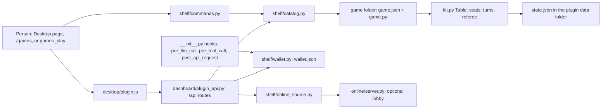

# Architecture

_Applies to Game Center 1.0.0 · last revised 2026-11-13 (0ad31b96)_

What the pieces are, how a move travels through them, and where the data lives.

## The pieces

| Component | Path | What it does |
|---|---|---|
| Plugin entry | `__init__.py` | `register(ctx)` wires `/games`, the `games_play` tool, three hooks, the **Game Shelf opponent** model slot and the win-bonus sink. |
| Table kit | `kit.py` | The shared `Table`: seats, turns, consent, referee, saves, lessons, review and the built-in player. Game rules subclass or use it. |
| Shelf | `shelf/` | Catalog and discovery, the `/games` command router, wallet, jackpot, slot play, online client, champions, tournaments, lessons, library and helpers. |
| Game folders | `connect4/`, `chessboard/`, … | One folder per game: `game.json`, `game.py`, and usually `learn.json` / `lesson.json`. Eighteen ship here. |
| Desktop page | `desktop/src/NN-*.js` → `desktop/plugin.js` | The React page Hermes Desktop loads. `tools/build_plugin.py` glues the numbered parts into one ES module. |
| Plugin HTTP API | `dashboard/plugin_api.py` | A FastAPI `APIRouter`; Hermes mounts it under `/api`. The Desktop page and the browser QA server call it. |
| Online lobby | `online/` | An optional aiohttp server: accounts, rooms, chat, match queue, ladder, leagues, admin. Not used unless online play is on. |
| Talking tables | `talktable/`, `third_party/textarena/` | Adapter and vendored TextArena rules for Mafia, Liar's Dice, Prisoner's Dilemma and Blind Auction. |
| Curated lists | `shelf/curated.json`, `shelf/ship.json`, `community/games.json` | What is Play, the ship-gate inventory, and link-out community cards. |
| Tests and tools | `tests/`, `tools/` | Pytest suite, Node harnesses, the bundle build and the browser proofs. |

## How a move travels

1. A person clicks a board in `desktop/plugin.js` (or types `/games …` in chat, or a model calls `games_play`).
2. The page sends the command to `POST /api/command` in `dashboard/plugin_api.py`; chat goes to `shelf/commands.py`.
3. `shelf/catalog.py` finds the game by id, loads its `game.json`, imports its `game.py`, and hands the line to the game's `command()`.
4. A table game routes the move through `kit.py`: whose turn, is it legal, does the other person have to join first, does the referee refuse it.
5. The result is written to that game's `state.json`, and the reply carries the board, the move history and any refusal back to the page or the chat.
6. `shelf/wallet.py` pays a win bonus, counts tokens from the `post_api_request` hook, and the Jackpot's auto-spin may take a spin from the same wallet.

The page never judges a move. The same `kit.py` referee answers a click, a typed command and a model tool call, which is why a refusal reads the same in all three places.

## Discovery

`shelf/catalog.py` scans the folders that can hold a Hermes plugin: the active `HERMES_HOME` (or `~/.hermes`) `plugins` folder, the active profile's plugins folder, and the folder beside this checkout. A plugin folder contributes its own `game.json` and one folder of games beside its `plugin.yaml`. Only installed, enabled plugins are offered. The running plugin's own copy wins when the same game is found twice, so a checkout plays its own code.

`shelf/curated.json` is the reviewed Play list. A game that is not in it is Experimental, is never seated at a Play table, never enters a tournament and is never rated.

## Where data lives

`__init__.py` asks Hermes for the plugin data directory (`plugins.plugin_storage.plugin_data_dir("hermes-gameshelf")`). Under that folder:

| Path | What it holds |
|---|---|
| `<game_id>/state.json` | The current table for that game: seats, turn, move history, status, result and refusals. |
| `<game_id>/learn.json`, `lesson.json` | Shipped lesson content, read by the game; not written by play. |
| `wallet.json` and `wallet.lock` | Chips, points (`bonus`), token counters, slot settings, over-chat size and opacity, streaks and the recent spin feed. |
| `setup.json` | The first-run welcome, per-game alert switches, pause and the local AI-seat choice (`shelf/setup.py`). |
| `players.json` | Local display names, per platform identity (`shelf/who.py`). |
| `champions/` | Saved champion playbooks (`shelf/champions.py`). |
| `ratings.json` | Elo ratings (`shelf/tournament.py`). |
| `tournaments/` | Saved tournament result files. |
| `online.json` | Online-play preference and non-secret session state (`shelf/online_source.py`); the recovery key is not here. |
| `installed.json` | Which catalogue titles this profile added (`shelf/library.py`). |
| `directory.json` | Live/stopped vendor worlds for World games (`shelf/directory.py`). |

The online recovery key lives in Hermes's credential store under `HERMES_GAMESHELF_LOBBY_KEY`, never in a file of the plugin's own. The online server keeps its own `online.sqlite3` under the `--data` folder you give it.

## Key files

| File | Why it matters |
|---|---|
| `shelf/catalog.py` | Game discovery, the curated gate, install/remove, and the `play()` path into a game. |
| `shelf/commands.py` | `/games` routing: install, name, allow-ai, looking, chat, doom, host, and the game id. |
| `kit.py` | Table state machine shared by every game: seats, consent, move legality, draw, resign, rematch, lesson, review. |
| `shelf/wallet.py` | The single wallet, its lock, token-to-point arithmetic and points-to-chips conversion. |
| `shelf/jackpot.py`, `shelf/slotplay.py`, `shelf/reels.py` | Slot machines, bets, payouts, auto-spin and auto-bet. |
| `shelf/online_source.py` | The client for the optional lobby; it never stores the recovery key itself. |
| `dashboard/plugin_api.py` | Every `/api` route the Desktop page uses; see [REFERENCE.md](REFERENCE.md). |
| `desktop/src/30-game-page.js` | The table screen and its move input. |
| `desktop/src/70-home.js` | The Games page: Play, Experimental, lobby and tabs. |
| `tools/build_plugin.py` | Concatenates `desktop/src/NN-*.js` into `desktop/plugin.js`; `--check` is part of the test suite. |
| `online/server.py` | The opt-in lobby server. |

## Boundaries

- Game rules live in each game's `game.py`; the shelf never decides a move.
- The page and the chat both call the same shelf; neither owns state.
- Online is a client/server boundary: with online play off, `shelf/online_source.py` makes no request.
- `third_party/` and `vendor/` are read-only copies with their own licences; see [../THIRD-PARTY-NOTICES.md](../THIRD-PARTY-NOTICES.md).

Back to [docs/README.md](README.md).
