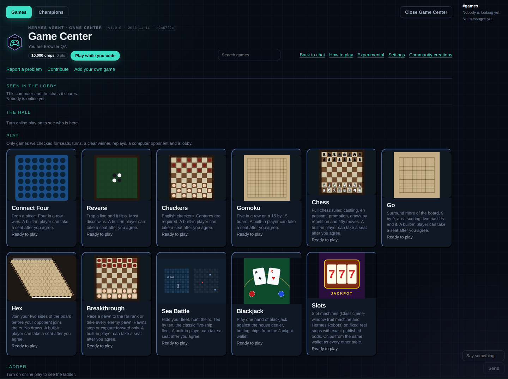
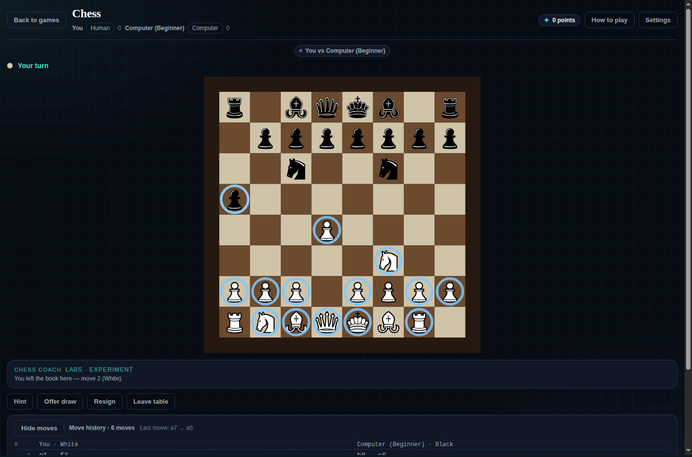
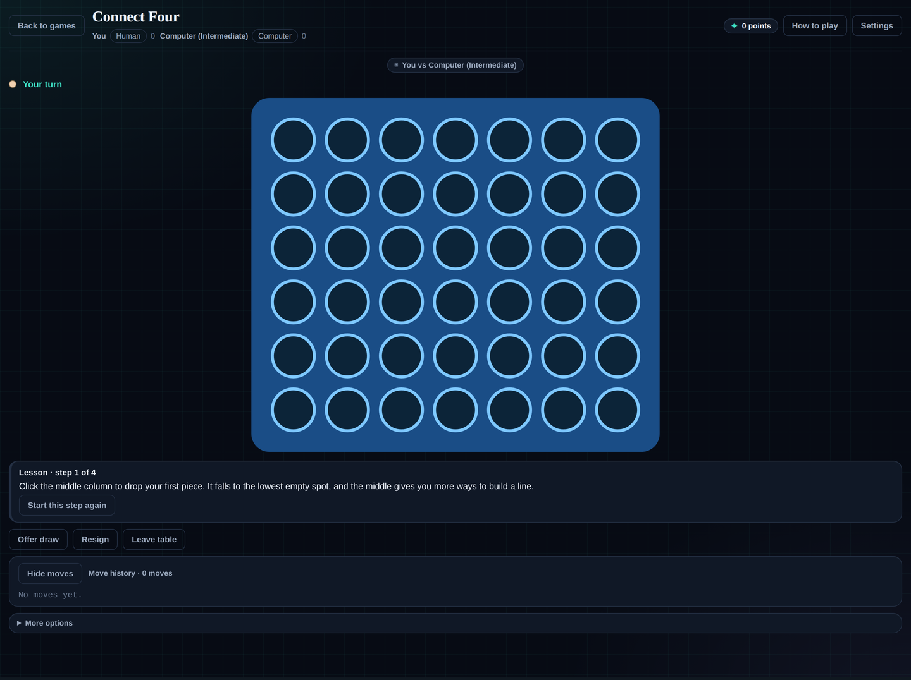
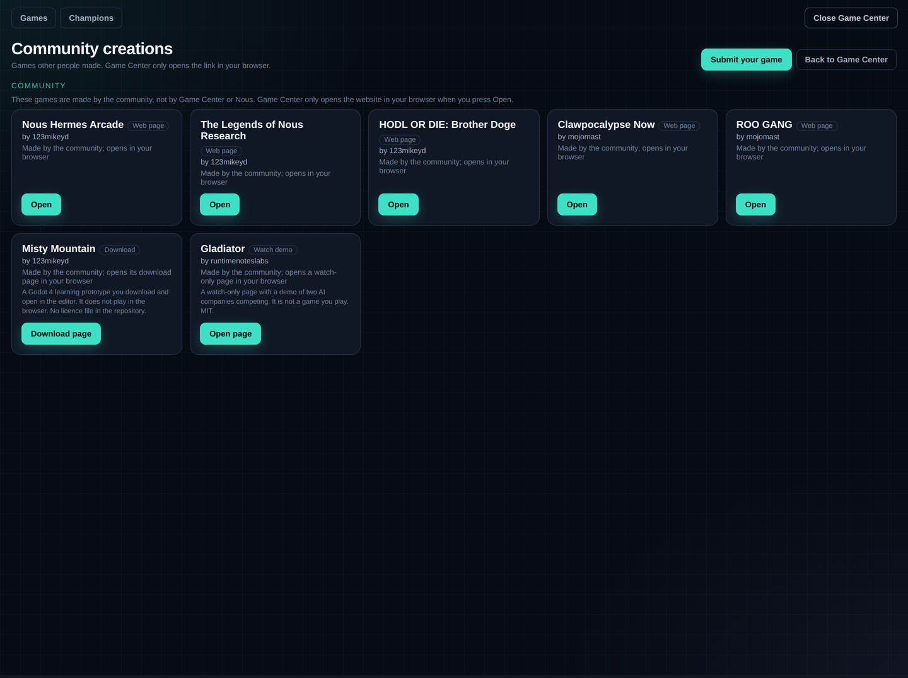
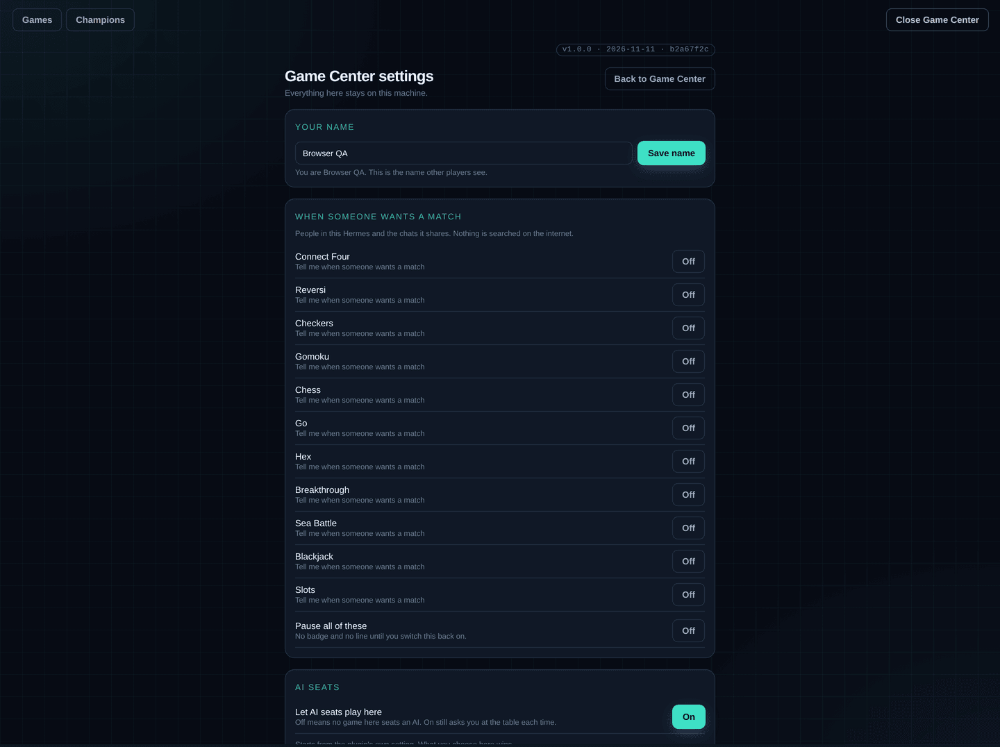
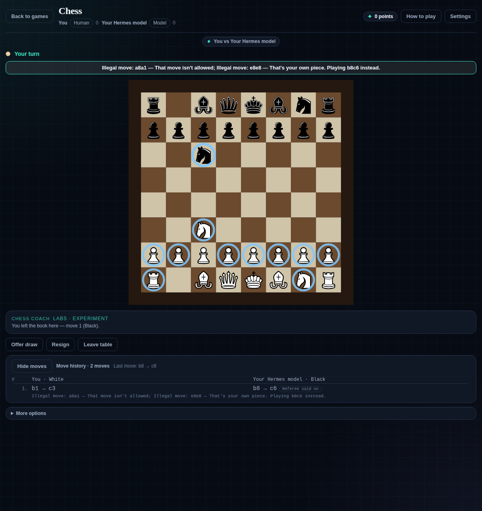

# Usage

_Applies to Game Center 1.0.0 · last revised 2026-11-18 (07e35119)_

A walkthrough of each user-facing feature, from the shelf to a finished game.

## Open the shelf

In Hermes Desktop, choose **Games** in the sidebar. The Play shelf opens with the lobby beside it. The version chip at the top names this install: `v1.0.0 · 2026-11-11 · <commit>`, click to copy.



Above the Play shelf, beside your chips and points, is **Inference Slot Machine** — **Start Inference Slot Machine** turns the
wallet's automatic spin and the Jackpot backdrop on together, so the machine really spins each time Hermes starts
thinking; **Stop Inference Slot Machine** turns both off. The button follows both switches: if either is turned off in the
cabinet, the status bar or Settings, it reads **Start** again. A refused request returns it to its real state and says why
in one line.

The eleven Play cards are the curated list. **Experimental**, **Settings** and **Community creations** are side links above them. `/games` in chat lists the same shelf as text.

## Put your name on it

Game Center has no default player name. The welcome, Settings and the online sign-in all open with an empty name box, and each has **Suggest a name** beside it: one press fills the box with a fresh name (draw a new one by pressing again), or you type your own. Nothing is sent anywhere by picking a name; it is what the table and other players see.

## Start a game

1. Press a Play card, for example **Connect Four**.
2. Choose a level: **Beginner**, **Intermediate**, **Advanced** or **Expert**. You are seated; the built-in player takes the other seat.
3. Click the board to move. In Connect Four, click a column; in Chess, click a piece and then a square.

The table shows whose turn it is, the move history, and the actions for this game: **Hint**, **Offer draw**, **Resign**, **Leave table**, **Review my game** and **More options**.



The same table is available in chat:

```
/games connect4 new white=human black=local level=beginner
/games connect4 move 4
/games connect4 state
```

## Learn the rules on a real board

**Learn to play** walks three or four steps on a real position, replayed through the game's own rules. Lessons are never scored or recorded.

1. Open a Play game, then **Learn to play** (under **More options** on some screens).
2. Read the step and make the move it asks for. **Next step** advances when the board agrees.
3. **Start this step again** resets the position for that step.



In chat: `/games <game> lesson`, then `/games <game> lesson next`.

## Play a person

- **Same screen:** choose **Two players** on the game screen. The second person takes the other seat.
- **Online:** the Games page's **Get online** card is the way in: turn **Online play** on, pick a name (**Create my player** / **Suggest a name**) or sign in with the one you have (**I have a player**), then use the Hall's roster, chat and play requests. The person who receives a request sees *"X wants to play … — Join / Not now"*. Join seats both at a private table. If the lobby refuses your saved sign-in, the Hall says so (nobody can see you until you sign in again with your name and recovery key, **I have a player**) instead of telling you to turn online play on.

A move never silently takes a seat. The other person must type `/games <game> join` or take the free seat before moving. `resign` ends your seat, `leave` opens it before play, `abandon` ends the table without a win, and `draw` / `draw accept` offer and accept a draw.

## Seat your own model

```
/games allow-ai chess black=agent
```

Your Hermes model gets the board, the rules and the legal moves, never player names, and must answer with one legal move. It gets two tries; after that the built-in player moves for it. One model call per move. Choose the model under **Settings → Models → Game Shelf opponent**; unset, it follows your main model.

`/games allow-ai chess black=local` seats the built-in player instead. A model calling `games_play` cannot take a seat on its own, and `allow_ai: false` turns every AI seat off.

## Hint and review

- **Hint** works only for one person against the built-in player, on their own turn. The built-in player picks the move; inside Hermes your model adds one short reason. It is never available against another person and never from a tool call.
- **Review my game** looks at one move you could have played better. Nothing is scored and you can play again right after.

## Points and chips

The version chip line shows the wallet: chips and points.

- **Chips** are the cabinet's and the tables' play money. Blackjack and Slots bet them.
- **Points** are the account currency: 100 for each game you win, and 10 per 1,000,000 tokens your chats use.
- Points convert to chips at 75% (four points buy three chips). The Jackpot panel has a slider, a number and **Max**.

See the wallet file and its keys in [ARCHITECTURE.md](ARCHITECTURE.md) and [CONFIGURATION.md](CONFIGURATION.md).

## Blackjack

Open **Blackjack** on the Play shelf and bet chips from the wallet. The dealer stands on all 17s, and the table stays open between hands.

**Who is dealing is written on the felt**, in one line under the DEALER label, in every setup: `Dealer: Computer (instant)` for the built-in computer, `Dealer: Hermes model <name> (follows house rules, instant)` for your own model, and `Dealer: Computer (house rules, instant)` for a table that has not seated a machine yet. **The dealer has no decisions in blackjack**: its play is the house rules (hit below 17, stand on all 17s), so every dealer — the built-in computer, your Hermes model, and the plain house — plays its cards out inside the same request. Nothing is left waiting on a second request, a model in the dealer's seat is never asked for a turn, and no "Referee said no" badge is ever written for it. A save from an older build that still reads phase `dealer` plays its cards out on the next move.

**The three ways in** are on the start screen by name: **Play vs computer dealer**, **Play vs my Hermes model dealer**, and **Two players (same screen)**. **Leave table** sits beside them above the felt while you are seated, so the row under the board never draws a second one — the rest of that row (**Hint**, and **Undo move** in a lesson) stays where it was. Leaving between hands costs nothing and is one press; leaving with a hand still being played asks first and says that hand's bet is lost — a session table never uses the word forfeit.

**Two players on one screen** is two seats against one dealer. Both bet (Player 1, then Player 2), both are dealt, Player 1 plays every hand of their round, then Player 2, and only then does the dealer play. Each hand settles on its own. Player 2's chips are a **table-only stack of 10,000** kept in the table state (`state.json`, key `guest`): a guest never spends or wins the Jackpot wallet's chips, and the felt says so under their seat. A save that lost that record — a hand-edited file, a write cut short — is repaired on the next read of the table and **kept**, so the guest's stack stays their own. `players=2` on the setup line is what seats them (`/games blackjack allow-ai black=local players=2`).

- **The moves are the table's, not the page's.** Hit, Stand, Double and Split are drawn from the rules: a move that is not on offer is disabled, and a hand with a short stack gets no Double or Split.
- **Double** is offered on the first two cards only. It puts a second bet of the same size on the felt, deals exactly one more card, and that hand stands. A doubled hand wins or loses twice its wager, and the next hand starts from what you bet, not from the double.
- **Split** is offered on two cards of the same rank (A/A, 8/8, K/K). It puts a second bet of the same size on the felt, deals one card to each hand, and the two hands are played one after the other. The felt names the hand you are playing and shows each hand's wager and result; the round's net result is the sum of its hands.
- **Split aces** are dealt the casino way: exactly one card to each, no further hit and no double. An ace with a ten after a split is 21 that pays even money, not a 3:2 blackjack.
- **The dealer waits for every hand**, and does not play at all when every hand has busted.
- **Payouts:** blackjack pays 3:2, a plain win pays 1:1, a push returns the stake. A split hand that reaches 21 never gets the 3:2 bonus.
- **House rules kept as flags in `blackjack/game.py`:** pairs split on the same rank only (a king and a queen are behind `SPLIT_EQUAL_VALUE`, off by default), resplitting aces is off (`RESPLIT_ACES`), double after a split is on (but never on split aces), and a round holds up to four hands (`MAX_HANDS`).

## Slots and the Jackpot cabinet

Open **Slots** on the Play shelf. Pick a bet (25 chips up) and press **Spin**.

- **Classic** is a nine-window, five-payline machine; **Hermes Olympus** is one line on three Greek reels. You can switch mid-session.
- **Inference Slot Machine** spins while Hermes is working, and only while a machine is on screen and only for the chat you are looking at. Both cabinets' switches and the Games-page button carry the same one-line help: *One spin each time Hermes starts thinking, and only while this machine is on screen.* In full: one spin for your own message (at least double the smallest bet, sized by what the turn before it cost), one per burst of tool calls at the smallest bet, and none for the model's intermediate replies - those pay points instead. A chat that is not on screen, a delegated subagent, and a report older than a minute all spin nothing.
- **Auto-bet** sizes each stake by what the message or the reply cost.
- **Show as backdrop** draws a see-through copy at the top centre of the conversation, centred over the message box (the composer's own slot), so it is on screen exactly while the conversation is, and never floats over another screen. It stays at the top with the status bar hidden (Simple mode) too. Its size and how see-through it is (5% to 100%, 50% by default) are set in the cabinet itself. **Backdrop size** and **Backdrop opacity** are shared by the cabinet, the status bar and Settings. 100% is 640 px tall, twice the old copy, and at 100% never more than 60% of the window's height; a bigger size grows it up to 95% of the window. **Normal** / **Bigger** / **Biggest** in the cabinet set 100% / 150% / 200% in one press. The backdrop is a picture: nothing in it takes a click.

The screen prints no odds. The mechanics and payouts are in `shelf/jackpot.py` and `shelf/slotplay.py`; the audit script is `scripts/slot-audit.py`.

## Talking tables

Start one in chat: `/games mafia new`, `/games liars_dice new`, `/games prisoners_dilemma new` or `/games blind_auction new`. Each seat can be you, the built-in player or your model. The message box opens only while the game is in a talking phase, and another player's words are fenced and length-limited before a model reads them.

**Watch it think** shows a model seat's four Read answers, at most 80 tokens of private working, and its action in the side panel of the person who owns that bot. No opponent's screen carries it.

These tables are on the Experimental shelf, whose cards are locked for now; start them from chat.

## Doctrine and Olympus Arena

Doctrine is a JSON card: a name and eight whole-number priorities from 0 to 100. Four house cards ship. A battle is deterministic, seeded and turn-based, and no model is called during it, so the same seed and cards replay identically.

**Improve** sends your card to the Game Shelf opponent model, validates the reply, and plays it over five seeds in both seats; the new card is kept only if it wins more.

Both live on the Experimental shelf; their cards are locked for now.

## Community creations

**Community creations** lists games other people made and host on their own sites. Game Center loads none of them: press **Open** and the address goes to your own browser through the Desktop's `openExternal`. A bad entry is skipped with a plain note. **Submit your game** opens the submission form: pick a community game or a Game Center game, fill it in, and Game Center builds a GitHub issue for your own browser to send. [SUBMIT-A-GAME.md](SUBMIT-A-GAME.md) explains the three levels.



## Settings

**Settings** holds your display name, the per-game match-alert switches, **Pause all of these**, the AI-seat switch, table sounds and the Jackpot backdrop switch. Every choice stays on this machine.



## The referee's refusal

When a model seat proposes an illegal move, the referee names the move and the reason in one sentence, refuses it, and the built-in player moves instead. The sentence is badged on the move and written into the game's own state.



The wording comes from the table's refusal path in `kit.py`; the page draws it from `pictured.refusals` in `desktop/src/30-game-page.js`.

## Play while you code, beside the chat

The pane on the right of the conversation is its own small Games screen. Open it from the Games header, from the status bar item, or with its command in the palette.

- The pane is always on the right of the chat. Its dock hint is enforced, so the host re-homes it there on every start: a pane that was once dragged somewhere else, or moved by a host update, goes back to the right instead of staying wrong for good.
- The pane opens at 368 px. Drag its edge: it goes down to 300 px and out to 1200 px.
- Everything inside answers to that width. The game list fills the row it is in, and the pane's sections (the game list, online play, alerts) sit two abreast once there is room, then stack again when the pane is narrow.
- A game in the pane draws its board as large as the pane allows, capped by the pane's height so the turn line stays in view, and puts the turn beside the board when there is room for both. Nothing scrolls sideways, down to 300 px.

## Online play

Online play is off until you turn it on in the lobby. With it on, you get the Hall (roster, `#games` chat and play requests), optional match alerts and the bot ladder. The exact list of what is sent is in [ONLINE-PLAY.md](ONLINE-PLAY.md); the one-sentence disclosure is on the dock's **Lobby** tab before you switch it on.

Back to [docs/README.md](README.md).
