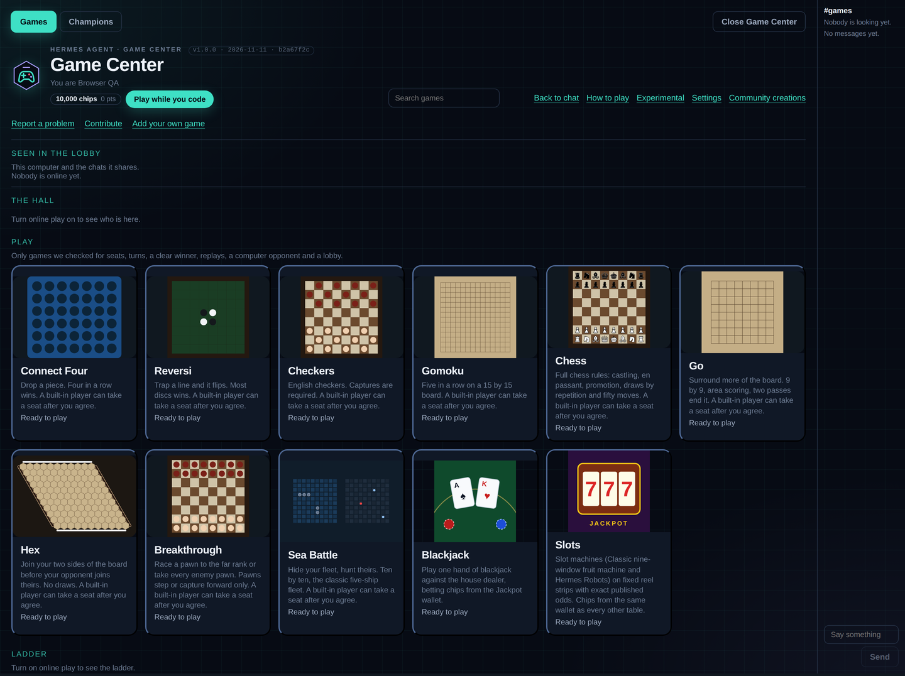
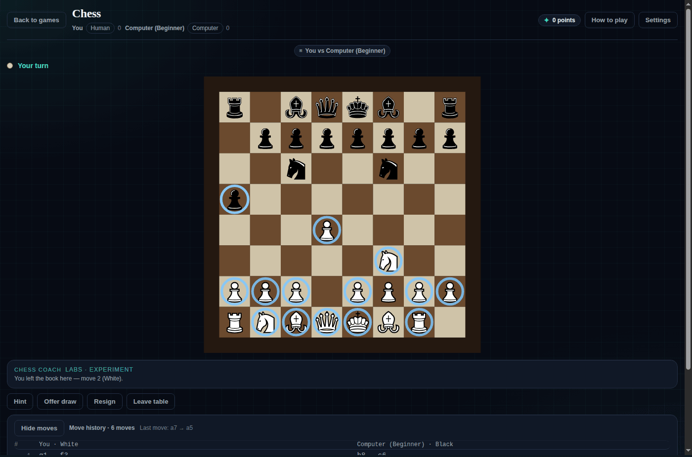
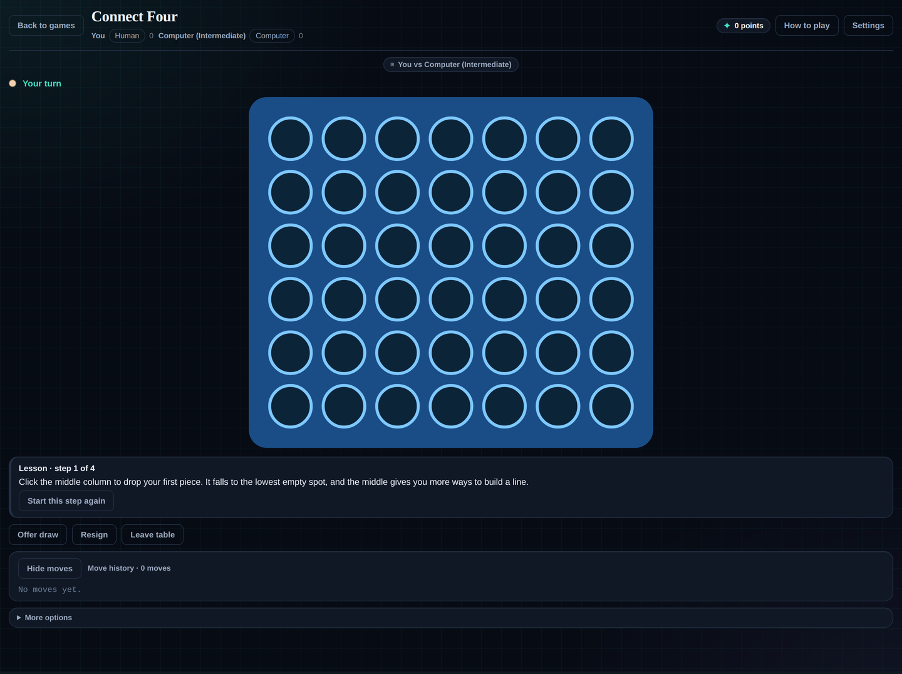
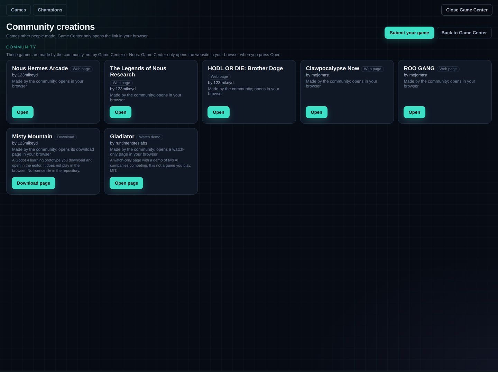
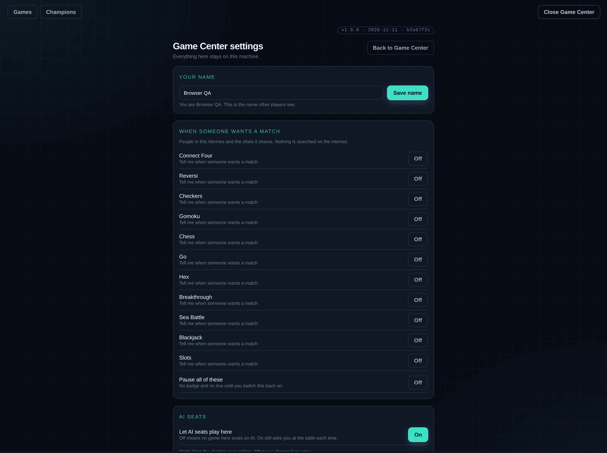
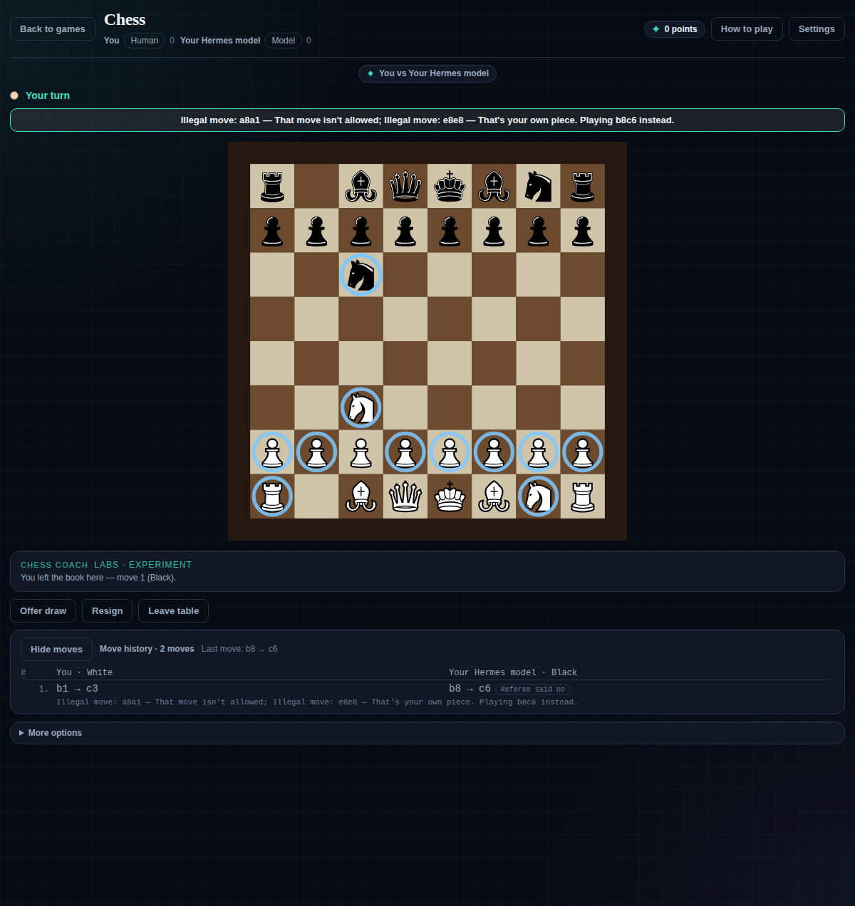

# Usage

_Applies to Game Center 1.0.0 · last revised 2026-11-12 (54c502d6)_

A walkthrough of each user-facing feature, from the shelf to a finished game.

## Open the shelf

In Hermes Desktop, choose **Games** in the sidebar. The Play shelf opens with the lobby beside it. The version chip at the top names this install: `v1.0.0 · 2026-11-11 · <commit>`, click to copy.



The eleven Play cards are the curated list. **Experimental**, **Settings** and **Community creations** are side links above them. `/games` in chat lists the same shelf as text.

## Start a game

1. Press a Play card, for example **Connect Four**.
2. Choose a level: **Beginner**, **Intermediate**, **Advanced** or **Expert**. You are seated; the built-in player takes the other seat.
3. Click the board to move. In Connect Four, click a column; in Chess, click a piece and then a square.

The table shows whose turn it is, the move history, and the actions for this game: **Hint**, **Offer draw**, **Resign**, **Leave table**, **Review my game** and **More options**.



The same table is available in chat:

```
/games connect4 new white=human black=local level=beginner
/games connect4 move 4
/games connect4 state
```

## Learn the rules on a real board

**Learn to play** walks three or four steps on a real position, replayed through the game's own rules. Lessons are never scored or recorded.

1. Open a Play game, then **Learn to play** (under **More options** on some screens).
2. Read the step and make the move it asks for. **Next step** advances when the board agrees.
3. **Start this step again** resets the position for that step.



In chat: `/games <game> lesson`, then `/games <game> lesson next`.

## Play a person

- **Same screen:** choose **Two players** on the game screen. The second person takes the other seat.
- **Online:** turn on **Online play** in the lobby, then use the Hall's roster, chat and play requests. The person who receives a request sees *"X wants to play … — Join / Not now"*. Join seats both at a private table.

A move never silently takes a seat. The other person must type `/games <game> join` or take the free seat before moving. `resign` ends your seat, `leave` opens it before play, `abandon` ends the table without a win, and `draw` / `draw accept` offer and accept a draw.

## Seat your own model

```
/games allow-ai chess black=agent
```

Your Hermes model gets the board, the rules and the legal moves, never player names, and must answer with one legal move. It gets two tries; after that the built-in player moves for it. One model call per move. Choose the model under **Settings → Models → Game Shelf opponent**; unset, it follows your main model.

`/games allow-ai chess black=local` seats the built-in player instead. A model calling `games_play` cannot take a seat on its own, and `allow_ai: false` turns every AI seat off.

## Hint and review

- **Hint** works only for one person against the built-in player, on their own turn. The built-in player picks the move; inside Hermes your model adds one short reason. It is never available against another person and never from a tool call.
- **Review my game** looks at one move you could have played better. Nothing is scored and you can play again right after.

## Points and chips

The version chip line shows the wallet: chips and points.

- **Chips** are the cabinet's and the tables' play money. Blackjack and Slots bet them.
- **Points** are the account currency: 100 for each game you win, and 10 per 1,000,000 tokens your chats use.
- Points convert to chips at 75% (four points buy three chips). The Jackpot panel has a slider, a number and **Max**.

See the wallet file and its keys in [ARCHITECTURE.md](ARCHITECTURE.md) and [CONFIGURATION.md](CONFIGURATION.md).

## Slots and the Jackpot cabinet

Open **Slots** on the Play shelf. Pick a bet (25 chips up) and press **Spin**.

- **Classic** is a nine-window, five-payline machine; **Hermes Olympus** is one line on three Greek reels. You can switch mid-session.
- **Auto-spin** spins while Hermes is working: one per reply and one per tool call, only while a machine is on screen.
- **Auto-bet** sizes each stake by what the reply cost.
- **Show over chat** draws a see-through copy in the strip under the message box (the composer's own slot), so it is on screen exactly while the conversation is, and never floats over another screen. Its size and opacity controls are shared by the cabinet, the status bar and Settings.

The screen prints no odds. The mechanics and payouts are in `shelf/jackpot.py` and `shelf/slotplay.py`; the audit script is `scripts/slot-audit.py`.

## Talking tables

Start one in chat: `/games mafia new`, `/games liars_dice new`, `/games prisoners_dilemma new` or `/games blind_auction new`. Each seat can be you, the built-in player or your model. The message box opens only while the game is in a talking phase, and another player's words are fenced and length-limited before a model reads them.

**Watch it think** shows a model seat's four Read answers, at most 80 tokens of private working, and its action in the side panel of the person who owns that bot. No opponent's screen carries it.

These tables are on the Experimental shelf, whose cards are locked for now; start them from chat.

## Doctrine and Olympus Arena

Doctrine is a JSON card: a name and eight whole-number priorities from 0 to 100. Four house cards ship. A battle is deterministic, seeded and turn-based, and no model is called during it, so the same seed and cards replay identically.

**Improve** sends your card to the Game Shelf opponent model, validates the reply, and plays it over five seeds in both seats; the new card is kept only if it wins more.

Both live on the Experimental shelf; their cards are locked for now.

## Community creations

**Community creations** lists games other people made and host on their own sites. Game Center loads none of them: press **Open** and the address goes to your own browser through the Desktop's `openExternal`. A bad entry is skipped with a plain note. **Submit your game** opens the submission page; [SUBMIT-A-GAME.md](SUBMIT-A-GAME.md) explains the three levels.



## Settings

**Settings** holds your display name, the per-game match-alert switches, **Pause all of these**, the AI-seat switch, table sounds and the Jackpot over-chat switch. Every choice stays on this machine.



## The referee's refusal

When a model seat proposes an illegal move, the referee names the move and the reason in one sentence, refuses it, and the built-in player moves instead. The sentence is badged on the move and written into the game's own state.



The wording comes from the table's refusal path in `kit.py`; the page draws it from `pictured.refusals` in `desktop/src/30-game-page.js`.

## Online play

Online play is off until you turn it on in the lobby. With it on, you get the Hall (roster, `#games` chat and play requests), optional match alerts and the bot ladder. The exact list of what is sent is in [ONLINE-PLAY.md](ONLINE-PLAY.md); the one-sentence disclosure is on the dock's **Lobby** tab before you switch it on.

Back to [docs/README.md](README.md).
